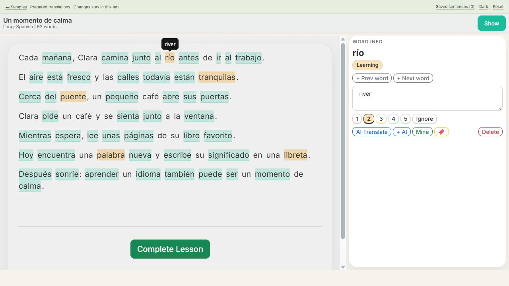
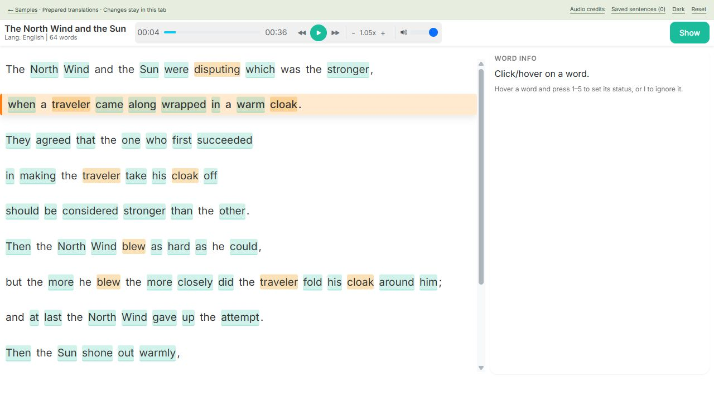

# LinguaRead

A self-hosted reading and listening workspace with integrated FSRS, sentence
mining, and your choice of AI provider. Bring your own books/articles, track words
in context, save useful sentences, and review them later.

Built for intermediate learners who already read in a language they study.

[Try the interactive demo](https://semblable.github.io/Lingua_read2/) ·
[Install with Docker](#installation-docker) · [Features](FEATURES.md) ·
[Settings](SETTINGS.md) · [Contribute](CONTRIBUTING.md)

The static demo uses the real reader/player with prepared responses and temporary
sample data. It needs no account or API key. Imports, live AI, offline sync, and
FSRS scheduling run in the full application. [Run the demo locally](client/lingua-read-client/demo/README.md).


*Real reader component in the static Spanish sample; translations are prepared.*


*Static listening sample: human recording from P. Roach / International Phonetic
Association, CC BY-SA 3.0; caption-derived transcript CC BY-SA 4.0.
[Media attribution and changes](client/lingua-read-client/demo/public/audio/ATTRIBUTION.txt).*

## What you can do

- Import TXT/EPUB books, organize lessons, and track reading progress.
- Look up words and phrases, set familiarity levels, and mine sentences for
  configurable FSRS-6 review, including cloze cards and reading credit.
- Play supplied audio with SRT transcripts, seek by cue, and resume audiobook
  playlists. Download material for offline use and replay supported queued activity
  when reconnected.
- Choose translation and AI providers, including compatible local endpoints;
  customize per-task models/prompts, reader appearance, and review settings.
- Export vocabulary, view reading/listening statistics, and back up your data.

See the [features guide](FEATURES.md) for details and [architecture and engineering
notes](docs/ARCHITECTURE.md) for how the pieces fit together.

## Status and language limitations

LinguaRead is **experimental and under active development**. Bugs, incomplete
features, UI changes, and data migrations are possible. Back up before upgrading.
It is a personal workspace using a shared default user, with no tenant-isolation
promise for unrelated users. Support is best-effort from a solo maintainer with a
full-time job; there are no response-time or availability commitments.

The demo provides Spanish reading and English listening examples. Configurable
language entries do not establish that every language works equally well.
Space-delimited parsing, normalization, sentence rules, dictionaries, and RTL
settings are configurable. **Japanese MeCab and Chinese Jieba segmentation are
not implemented.** Verify a short passage in your own language before importing
an entire library; see [adding languages](LANGUAGES_GUIDE.md).

The maintainer reports acceptable personal operation on an Oracle Cloud free-tier
micro instance with swap enabled and good mobile performance in their own
workflow. Actual host specifications and representative measurements remain to
be [recorded](docs/DEPLOYMENT_EVIDENCE.md). These observations do not establish a
minimum VM size, concurrent-user capacity, or broad device support. PostgreSQL's
Compose defaults are tuned for roughly 4 GB hosts; smaller machines need reviewed
configuration and measurement.

## Installation (Docker)

Install Git and Docker with the Compose plugin (Docker Desktop on Windows/macOS),
then start Docker. No host Node.js, .NET SDK, or PostgreSQL installation is needed.

```sh
git clone https://github.com/semblable/Lingua_read2.git
cd Lingua_read2
```

Copy `.env.example` to `.env`:

```powershell
# Windows PowerShell
Copy-Item .env.example .env
notepad .env
```

```sh
# macOS / Linux
cp .env.example .env
# Open .env with your preferred editor.
```

Set `POSTGRES_PASSWORD` and a random `JWT_KEY` of at least 32 characters. Generate
a key locally with PowerShell's cryptographic random generator:

```powershell
$jwtBytes = New-Object byte[] 32
$jwtRng = [System.Security.Cryptography.RandomNumberGenerator]::Create()
$jwtRng.GetBytes($jwtBytes)
[Convert]::ToBase64String($jwtBytes)
$jwtRng.Dispose()
```

Or use `openssl rand -base64 32` on macOS/Linux. Keep `.env` private. Provider keys
are optional; unconfigured provider features are unavailable. Set
`LINGUAREAD_PASSWORD` before first startup. Alternatively, configure a random
`LINGUAREAD_SETUP_TOKEN` and enter that operator token on the setup page along
with your chosen password. Outside Development, setup requires this token.
Remove the token after setup; keep the initial connection trusted and local.

```sh
docker compose up --build -d
docker compose ps
```

The first build can take several minutes. Open [http://localhost](http://localhost)
and set up/sign in with your password. The normal stack has three services: `db`,
`api`, and `nginx`. The optional backup service starts only with its profile.

This plain-HTTP setup is for local evaluation. Authentication cookies are secure
outside Development, so a plain-HTTP address on another device can prevent login.
For a server/phone over a network, configure HTTPS using the production settings
and complete setup before allowing untrusted access. See [settings](SETTINGS.md)
and the [security policy](SECURITY.md).

| Service | Local access |
| --- | --- |
| App | [http://localhost](http://localhost), port 80 |
| API | [Readiness](http://localhost:5000/api/Health/ready), loopback port 5000 via the development override |
| Database | Internal Compose service `db:5432`; not published to the host by default |

## Manage, back up, and upgrade

| Task | Command or guide |
| --- | --- |
| Stop, preserving volumes | `docker compose down` |
| Restart | `docker compose restart` |
| View logs | `docker compose logs -f` (Ctrl+C to exit) |
| Upgrade and recover | [Backup and upgrade guide](docs/BACKUP_AND_UPGRADE.md) |
| Advanced configuration | [Settings guide](SETTINGS.md) |

**Settings → Data Management → Download Backup** saves a PostgreSQL `.backup`.
It contains the database only. Preserve uploaded audio/EPUB assets and the
`api_dp_keys` encryption-key volume separately. Restoring only the database is
not a full-library recovery. Verify an isolated restore before relying on a
backup or upgrading. **Restore from Backup overwrites its target database.**

For optional automated cloud backups, configure the remote privately with
`bash setup.sh` in Git Bash/WSL/Linux, then start with
`docker compose --profile backup up -d`. The sidecar backs up the database and
media, but deliberately excludes the encryption keys; protect those separately.
See [backup expectations](docs/BACKUP_AND_UPGRADE.md).

## Troubleshooting

| Symptom | Next step |
| --- | --- |
| Cannot connect to Docker / commands hang | Start Docker Desktop or the Docker daemon and wait until ready. |
| Port 80 is in use | Change nginx's host mapping from `80:8080` to `8080:8080`, then open `http://localhost:8080`. |
| API stays unhealthy | Allow initial migrations to finish, then inspect `docker compose logs --tail 100 api`. |
| Setup/login fails | Check `.env` naming, JWT key length, password, and HTTPS/cookie behavior. |
| Missing provider feature | Configure that provider in Settings; no paid API is required to run the reader. |
| Need to reset disposable test data | `docker compose down -v` deletes volumes, including the database, media, and keys. Never use it to troubleshoot data you want to retain. |

[Report a bug](https://github.com/semblable/Lingua_read2/issues/new/choose) with your
version, device/browser, language, and a small reproducible example. Sanitize logs
and screenshots. Read [CONTRIBUTING.md](CONTRIBUTING.md) for development and support
scope, and [SECURITY.md](SECURITY.md) for private vulnerability reporting.

## License

Application code and original demo text: [MIT](LICENSE), Copyright (c) 2025
LinguaRead. Fonts, the FSRS port, and demo audio/captions retain their upstream
terms in [third-party notices](THIRD_PARTY_NOTICES.md). The English listening
screenshot contains CC BY-SA caption material; retain its attribution when reusing it.
