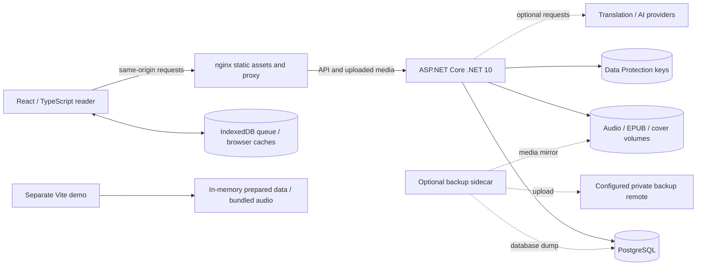

# Architecture and engineering notes

LinguaRead is a personal learning workspace. The normal Compose deployment has
three services. The static showcase is a separate browser-only build.

The app serves static assets and API requests from one origin. The API runs EF
Core migrations and background services, stores metadata and review history in
PostgreSQL, and stores uploaded media in named volumes. Provider credentials in
settings are protected using a persistent key ring. That key ring must be backed
up separately from database/media exports.

The PWA uses a service worker and browser caches for supported offline content,
with a separate IndexedDB mutation queue. Offline state belongs to that browser;
it is not included in a server backup. The demo imports the production reader
and player, replaces API access with an in-memory adapter, and blocks unsupported
or external fetches. It does not run migrations, real providers, or FSRS scheduling.

## Case study: keeping tokenization consistent

**Problem.** The reader and backend word linker need to agree on word boundaries
and lookup keys. Curly apostrophes, decomposed accents, soft hyphens in EPUBs,
and glued forms such as `l'eau` or `col·lecció` can otherwise split the same text
differently, breaking saved-word highlighting and matching.

**Implementation.** The TypeScript
[reader tokenizer](../client/lingua-read-client/src/utils/readerText.ts) and C#
[tokenizer](../server/LinguaReadApi/Services/Tokenization/Tokenizer.cs) normalize
input, apply built-in and language-specific substitutions, and retain supported
connectors between core word characters. Both test suites consume the same
[golden vectors](../tokenizer-golden-vectors.json), rather than maintaining two
independent expected-result files.

**Evidence and limits.** The frontend
[tokenizer suite](../client/lingua-read-client/src/__tests__/tokenizer.spec.js) and
backend [TokenizerTests](../server/LinguaReadApi.Tests/TokenizerTests.cs) check
the shared cases. These fixtures make drift reviewable; they do not prove correct
segmentation for every language. MeCab/Jieba currently fall back to the default
algorithm. Extend the shared corpus with a failing language-specific example
before modifying the parser, and run both suites.

## Case study: replaying offline activity without changing its meaning

**Problem.** A network request can succeed on the server while its response is
lost. Replaying a review or listening increment blindly could apply it twice.
Replaying an old playback position could also overwrite a newer device's progress.

**Implementation.** The IndexedDB
[queue](../client/lingua-read-client/src/utils/offline/syncQueue.ts) retains
mutations and coalesces supported last-write-wins operations. The production
[handlers](../client/lingua-read-client/src/utils/offline/handlers.ts) replay the
stored event IDs and timestamps instead of generating new ones. Reviews carry
the original review time and timezone; the
[SRS controller](../server/LinguaReadApi/Controllers/SrsController.cs) checks event
IDs and guards review time. Word-status replay sends only status, preserving
existing translations. Web Locks coordinate draining across supported browser tabs.

**Evidence and limits.** [Queue tests](../client/lingua-read-client/src/__tests__/syncQueue.test.js)
exercise FIFO ordering, coalescing, retry classification, and locking; the
[handler tests](../client/lingua-read-client/src/__tests__/offlineHandlers.test.ts)
check payload identity and status-only writes. These are deterministic tests,
not a field reliability measurement. Browser storage eviction, old queued
payloads, and browsers without Web Locks need explicit consideration; server-side
deduplication remains necessary. The static demo cannot verify this workflow.

## Attribution of engineering work

These are code-based walkthroughs of the repository, not claims about who
authored particular investigations or how much production reliability was measured.
Before using them in a portfolio, the maintainer should add their own contribution,
reproduction details, decisions, and any AI assistance honestly. This documentation
was prepared with AI assistance and checked against the referenced implementation
and available tests. Current verification and outstanding gates belong in the
[release record](RELEASE_VERIFICATION.md).
