> Historical input report. Its findings, severity labels and totals are unverified claims; see comprehensive-codebase-audit-report.md and REVIEW.md for current dispositions.

# Comprehensive Multi-Agent Codebase Audit Report: LinguaRead Platform

**Date:** November 6, 2026
**Target:** LinguaRead Repository (`dev` branch, post-commit `7f2ba809`)
**Architecture:** ASP.NET Core (.NET 10) Backend & React 19 / TypeScript Frontend
**Auditing Subagent Swarm:**
1. **Backend Systems Auditor** (`13875200-9949-4b2c-b3c2-bc066b317427`)
2. **Frontend & Reader Core Auditor** (`bc8493f3-e2d1-488c-93d2-ded15de4980f`)
3. **SRS, Library & Offline Persistence Auditor** (`9215dfd3-df8f-4d75-bf55-db95a1ecea0c`)
4. **Security, Auth & DevOps Auditor** (`1a68a67f-150e-4d1d-bde4-18d9fd1bcd87`)

---

## 1. Executive Summary

A comprehensive, multi-layer code audit was conducted across the entire LinguaRead codebase by four specialized subagents operating concurrently. The audit analyzed all ASP.NET Core controllers, EF Core models and migrations, scheduling algorithms, React 19 state lifecycles, audiobook media synchronization, IndexedDB offline queues, authentication/authorization boundaries, and containerized deployment infrastructure.

### Test Baseline Status
- **Backend (.NET 10 / C#):** `dotnet test` passed 1,825 unit/integration tests (9 skipped for external PostgreSQL integration, 0 failed).
- **Frontend (React 19 / TypeScript):** `npm run typecheck` passed with 0 errors; `vitest run` passed 1,988 tests across 122 test files (0 failed).

Despite a 100% test pass rate, deep semantic code-path tracing, race condition simulation, and security boundary evaluation uncovered **51 verified, deduplicated findings**:
- **Critical (6):** Exploitable SSRF, silent token relinking omission, audiobook initial-seek wiping, sentence-mode audio sync lockup, IndexedDB connection deadlocks, and offline word creation context loss.
- **High (17):** Fail-open admin policy, CSRF on database backups, Docker root container escape, stale streak metrics, library sort order collisions, subtitle arrow timestamp corruption, and offline queue 429 hammering.
- **Medium (20):** Goal baseline corruptions upon language resets, uncleaned audio files on book deletion, dot-delimited SRT timestamp parsing failures, and weak password policies.
- **Low (8):** Unpropagated cancellation tokens, uncleaned timers on component unmount, missing `setTimeout` delay parameters, and unpinned remote setup scripts.

---

## 2. Taxonomy & Severity Matrix

| Subsystem / Domain | Critical | High | Medium | Low | Total |
| :--- | :---: | :---: | :---: | :---: | :---: |
| **Security & DevOps** | 1 | 4 | 7 | 2 | **14** |
| **Backend & Data Integrity** | 1 | 3 | 3 | 2 | **9** |
| **Frontend & Reader Core** | 2 | 6 | 7 | 3 | **18** |
| **SRS, Library & Offline Persistence** | 2 | 4 | 3 | 1 | **10** |
| **Total** | **6** | **17** | **20** | **8** | **51** |

---

## 3. Critical Severity Findings (Action Required Immediately)

### [SEC-NEW-01] Full SSRF via Unrestricted Custom AI Provider Base URL & Health Checks
- **Subsystem:** Security / AI Integration
- **Files:**
  - [AiProvidersController.cs](file:///f:/Dev%20envitonment/Lingua_read2/server/LinguaReadApi/Controllers/AiProvidersController.cs#L58-L100)
  - [OpenAiCompatibleChatClient.cs](file:///f:/Dev%20envitonment/Lingua_read2/server/LinguaReadApi/Services/Ai/OpenAiCompatibleChatClient.cs#L42-L45)
  - [AiProviderCatalog.cs](file:///f:/Dev%20envitonment/Lingua_read2/server/LinguaReadApi/Services/Ai/AiProviderCatalog.cs#L100-L124)
- **Root Cause:**
  Users can configure custom OpenAI-compatible AI providers with an arbitrary `BaseUrl`. `AiProviderCatalog.TryNormalizeBaseUrl` validates only URL syntax, not destination IP ranges. `OpenAiCompatibleChatClient` instantiates an unconstrained `HttpClient` without `PublicAddressGuard`.
- **Attack Scenario:**
  An authenticated user sets `BaseUrl` to `http://169.254.169.254/latest/meta-data` (AWS/GCP instance metadata) or internal cluster services (`http://db:5432`, `http://127.0.0.1:8090`). Triggering `POST /api/aiproviders/{provider}/test` or `GET /api/aiproviders/{provider}/models` makes the server issue requests to the private address and echo internal responses back in `AiProviderTestResultDto.Message`.
- **Remediation:**
  Route custom AI provider HTTP clients through `PublicAddressGuard.CreateHandler()` to prohibit RFC 1918 subnets, loopback, and link-local metadata addresses.

---

### [BACKEND-NEW-01] Standard (Non-Profiled) Texts Silently Skip Relinking and Count Recalculation on Update
- **Subsystem:** Backend / Text Management & Vocabulary Linker
- **Files:**
  - [TextsController.cs](file:///f:/Dev%20envitonment/Lingua_read2/server/LinguaReadApi/Controllers/TextsController.cs#L979-L1038)
- **Root Cause:**
  `UpdateText` (`PUT /api/texts/{id}`) checks `var relinkProfiledText = text.SegmentationProfile != null && (text.Content != updateTextDto.Content || languageChanged);`. For all standard European and whitespace-delimited languages (English, German, Spanish, French, Russian), `SegmentationProfile` is `null`. The method falls through to simple metadata updating, skipping `WordLinker.RelinkAsync` entirely.
- **Trigger Scenario:**
  A user edits an English text, replacing the content with a new chapter or changing the text's language. The database updates `Content` and `LanguageId`, but `TextWords` still point to the old vocabulary tokens. Reader tooltips, word status highlights, and text word counters become permanently desynchronized.
- **Remediation:**
  Trigger `WordLinker.RelinkAsync` whenever `text.Content != updateTextDto.Content` or `languageChanged`, regardless of `SegmentationProfile`.

---

### [READER-NEW-01] Audiobook Saved Progress & Initial Seek Annihilated on Multi-Track Books
- **Subsystem:** Frontend / Audiobook Player
- **Files:**
  - [useAudiobookProgress.ts](file:///f:/Dev%20envitonment/Lingua_read2/client/lingua-read-client/src/hooks/audio/useAudiobookProgress.ts#L85-L124)
  - [useAudiobookPlayer.ts](file:///f:/Dev%20envitonment/Lingua_read2/client/lingua-read-client/src/hooks/useAudiobookPlayer.ts#L389-L433)
- **Root Cause:**
  `useAudiobookPlayer` defaults to Track 0 on mount. When asynchronous `loadProgress()` resolves with saved progress (e.g., Track 3 at 330s), it sets `setCurrentTrackIndex(3)` and calls `queueInitialSeek(330)`. Inside `queueInitialSeek`, `audioRef.current.readyState >= 1` is true for Track 0, so it immediately seeks Track 0 to 330s, marks `restoredContentKeyRef.current = contentKey`, and clears `initialSeekRef.current = null`. When React completes the switch to Track 3, `initialSeekRef` is null; Track 3 starts playing from 0:00, destroying user progress.
- **Remediation:**
  Bind `initialSeekRef` to a specific `targetTrackIndex`. Defer seeking until `handleLoadedMetadata` fires on the audio element for that exact track.

---

### [READER-NEW-02] Audio Sentence Sync Freezes in Sentence Mode When `displayMode === 'text'`
- **Subsystem:** Frontend / Reader Synchronization
- **Files:**
  - [useReaderAudioSync.ts](file:///f:/Dev%20envitonment/Lingua_read2/client/lingua-read-client/src/hooks/useReaderAudioSync.ts#L249-L265)
  - [TextDisplay.tsx](file:///f:/Dev%20envitonment/Lingua_read2/client/lingua-read-client/src/pages/TextDisplay.tsx#L2463-L2500)
- **Root Cause:**
  `handleAudioTimeUpdate` has a guard: `if (!snapIsAudioLesson || snapSrtLines.length === 0 || snapDisplayMode !== 'audio') return;`. When a learner listens to an audio lesson while in Sentence Mode (`displayMode = 'text'` and `isSentenceMode = true`), line 249 returns immediately. Sentence indices never update during playback; the sentence card remains frozen on sentence 0.
- **Remediation:**
  Permit audio updates when in Sentence Mode:
  ```typescript
  if (!snapIsAudioLesson || snapSrtLines.length === 0 || (!snapIsSentenceMode && snapDisplayMode !== 'audio')) return;
  ```

---

### [OFFLINE-NEW-01] Permanent IndexedDB Promise Deadlock on Initialization Error or Connection Closure
- **Subsystem:** Frontend / Offline Storage
- **Files:**
  - [syncQueue.ts](file:///f:/Dev%20envitonment/Lingua_read2/client/lingua-read-client/src/utils/offline/syncQueue.ts#L64-L80)
- **Root Cause:**
  `openDb()` caches the database promise in module-scoped `dbPromise`. If `req.onerror` fires (quota or storage permissions), `dbPromise` rejects but is never reset to `null`; subsequent calls permanently reject. Furthermore, `openDb()` registers no `db.onclose` or `db.onversionchange` handlers. When mobile browsers (notably iOS Safari) close idle background connections, subsequent transactions throw unrecoverable `InvalidStateError`s until a hard browser reload.
- **Remediation:**
  Reset `dbPromise = null` on error. Attach `db.onclose = () => { dbPromise = null; };` and `db.onversionchange = () => { db.close(); dbPromise = null; };`.

---

### [OFFLINE-NEW-05] Offline `createWord` Drops Sentence Context and Corrupts Reader UI State
- **Subsystem:** Frontend / Offline Sync & Vocabulary
- **Files:**
  - [words.ts](file:///f:/Dev%20envitonment/Lingua_read2/client/lingua-read-client/src/utils/api/words.ts#L34-L43)
  - [TextDisplay.tsx](file:///f:/Dev%20envitonment/Lingua_read2/client/lingua-read-client/src/pages/TextDisplay.tsx#L1796-L1805)
- **Root Cause:**
  1. `createWord(textId, term, status, translation, sentence)` receives the mined sentence context, but `PendingOp` only persists `{ textId, term, translation, status }`. The mined sentence is dropped upon offline replay.
  2. In offline mode, `createWord` returns `{ offline: true, queuedOp: ... }`. `TextDisplay.tsx` pushes this directly into `words` state. Because it lacks top-level `.term`, `.status`, and `.wordId`, `wordMap` ignores it. The word remains rendered as unlearned (status 0). Clicking it again queues duplicate create operations.
- **Remediation:**
  Include `sentence` in `wordCreate` `PendingOp` payload. Return a synthetic `Word` entity with top-level fields and a temporary negative ID when enqueued offline.

---

## 4. High Severity Findings

### [SEC-NEW-03] Fail-Open Admin Authorization Policy (`AdminOnlyPolicy`)
- **Files:** [AdminOnlyPolicy.cs](file:///f:/Dev%20envitonment/Lingua_read2/server/LinguaReadApi/Authorization/AdminOnlyPolicy.cs#L39-L44), [AdminController.cs](file:///f:/Dev%20envitonment/Lingua_read2/server/LinguaReadApi/Controllers/AdminController.cs#L20)
- **Issue:** `AdminOnlyHandler` checks `if (_allowedUserIds.Count == 0) { context.Succeed(requirement); }`. Because `Admin:AllowedUserIds` is empty by default, every authenticated user is granted administrative privileges. Endpoints like database backup (`GET /api/admin/backup`) and database restore (`POST /api/admin/restore`) become universally accessible.
- **Remediation:** Adopt a fail-closed model: if `_allowedUserIds` is empty, restrict access strictly to `DefaultUserId` or reject authorization.

### [SEC-NEW-04] CSRF Vulnerability on Destructive Database Backup via HTTP GET & Lax Cookies
- **Files:** [AdminController.cs](file:///f:/Dev%20envitonment/Lingua_read2/server/LinguaReadApi/Controllers/AdminController.cs#L41-L77), [Program.cs](file:///f:/Dev%20envitonment/Lingua_read2/server/LinguaReadApi/Program.cs#L600-L615)
- **Issue:** Authentication cookies use `SameSite = SameSiteMode.Lax`. Custom anti-CSRF middleware skips GET requests. Database backup is exposed on `GET /api/admin/backup`. An external website visited by an admin can trigger `<a href="https://lingua.local/api/admin/backup">`, inducing the browser to generate and download a full database backup.
- **Remediation:** Change backup endpoints to HTTP `POST` requiring the anti-CSRF header (`X-Requested-With`).

### [DEVOPS-NEW-01] Container Escape Risk: Root Execution with Host Docker Socket Mount
- **Files:** [backup/Dockerfile](file:///f:/Dev%20envitonment/Lingua_read2/backup/Dockerfile#L1-L21), [docker-compose.yml](file:///f:/Dev%20envitonment/Lingua_read2/docker-compose.yml#L156-L183)
- **Issue:** The backup container runs as `root` and mounts `/var/run/docker-host/docker.sock`. Any arbitrary command execution vulnerability inside the backup container allows immediate, unconfined root takeover of the host operating system.
- **Remediation:** Run under an unprivileged user and use a restricted Docker socket proxy (`tecnativa/docker-socket-proxy`) limiting access exclusively to container pause/unpause API routes.

### [DEVOPS-NEW-03] Missing Startup Validation for Default Placeholder JWT Keys
- **Files:** [.env.example](file:///f:/Dev%20envitonment/Lingua_read2/.env.example#L11-L16), [Program.cs](file:///f:/Dev%20envitonment/Lingua_read2/server/LinguaReadApi/Program.cs#L288-L291)
- **Issue:** `Program.cs` only asserts that `Jwt:Key` is non-empty. If an operator starts the system using `.env.example` defaults, the application uses a publicly known key (`CHANGE_ME_IN_PRODUCTION_...`), enabling unauthorized token forgery.
- **Remediation:** Add startup assertions that reject known default keys and enforce at least 256 bits of entropy.

### [BACKEND-NEW-02] `SrsController.GetSrsStatistics` Reports Stale Streaks for Inactive Users
- **Files:** [SrsController.cs](file:///f:/Dev%20envitonment/Lingua_read2/server/LinguaReadApi/Controllers/SrsController.cs#L659)
- **Issue:** `CurrentStreak` is read directly from `settings.SrsCurrentStreak`. This column is only updated when a card is reviewed. If a user with a 30-day streak becomes inactive for 6 months, `GET /api/srs/statistics` continues reporting a 30-day active streak until a new review occurs.
- **Remediation:** Compare the user's last recorded study day against today/yesterday in their local timezone before returning `CurrentStreak`.

### [BACKEND-NEW-03] `FoldersController.CreateFolder` Collides on SortOrder with Books and Texts
- **Files:** [FoldersController.cs](file:///f:/Dev%20envitonment/Lingua_read2/server/LinguaReadApi/Controllers/FoldersController.cs#L315-L326)
- **Issue:** `CreateFolder` queries `_context.Folders.MaxAsync(f => f.SortOrder)` to assign the next sort key, ignoring books and texts sharing the same parent folder. If a folder contains 3 books and 0 subfolders, the new folder is assigned `SortOrder = 0`, colliding with Book #1.
- **Remediation:** Use `GetMaxSortOrderInFolder(userId, dto.ParentFolderId)` which checks folders, books, and texts concurrently.

### [BACKEND-NEW-04] / [LIB-NEW-04] `FoldersController.UpdateFolder` Changes Parent Without Updating SortOrder
- **Files:** [FoldersController.cs](file:///f:/Dev%20envitonment/Lingua_read2/server/LinguaReadApi/Controllers/FoldersController.cs#L368-L384)
- **Issue:** Moving a folder to a new parent via `PUT /api/folders/{id}` updates `ParentFolderId` but leaves `SortOrder` unchanged, causing sort collisions or arbitrary order gaps in the destination folder.
- **Remediation:** When `ParentFolderId` changes, recalculate `folder.SortOrder = await GetMaxSortOrderInFolder(userId, targetParentId) + 1`.

### [READER-NEW-03] Standard vs Sentence Mode Title Block Index Desynchronization
- **Files:** [StandardTextView.tsx](file:///f:/Dev%20envitonment/Lingua_read2/client/lingua-read-client/src/components/reader/StandardTextView.tsx#L191-L202), [readerText.ts](file:///f:/Dev%20envitonment/Lingua_read2/client/lingua-read-client/src/utils/readerText.ts#L1520-L1532)
- **Issue:** Sentence Mode omits title blocks if empty/whitespace. Standard Mode unconditionally calls `renderSentence(..., currentSentenceIndex++)` on empty title lines. This shifts sentence indices in Standard Mode by +1 relative to Sentence Mode, breaking bookmark parity.
- **Remediation:** Verify that `block.lines.join('').trim().length > 0` before incrementing `currentSentenceIndex` in Standard Mode.

### [READER-NEW-04] StandardTextView Collapses Paragraph Line Breaks & Loses Text on Abbreviation Merges
- **Files:** [StandardTextView.tsx](file:///f:/Dev%20envitonment/Lingua_read2/client/lingua-read-client/src/components/reader/StandardTextView.tsx#L86-L96), [readerText.ts](file:///f:/Dev%20envitonment/Lingua_read2/client/lingua-read-client/src/utils/readerText.ts#L1481-L1491)
- **Issue:** `replace(/\s+/g, ' ').trim()` replaces intra-paragraph `\n` characters with single spaces, destroying the formatting of poetry, dialogue, and scripts. Furthermore, when abbreviation exceptions merge in `splitBlockIntoSentences`, they inject artificial spaces (`"No. 1"`). For languages without spaces (CJK/Thai), `normalized.indexOf` fails (`-1`), causing sentence boundaries to lose intervening characters.
- **Remediation:** Preserve intra-paragraph line breaks and avoid character-offset searching across altered abbreviation tokens.

### [READER-NEW-05] SRT Subtitle Dialogue Containing Arrows (`-->`) Drops Text & Corrupts Cue Timestamps
- **Files:** [srtParser.ts](file:///f:/Dev%20envitonment/Lingua_read2/client/lingua-read-client/src/utils/srtParser.ts#L27-L41)
- **Issue:** `parseSrtContent` checks `else if (currentEntry.startTime === 0 && trimmedLine.includes('-->'))`. For cues starting at `00:00:00,000`, any dialogue line containing `-->` (e.g. arrows in chemical formulas, math, or notes) is treated as a timestamp line, resetting cue timings to 0 and dropping dialogue text.
- **Remediation:** Implement a strict sequential parser state machine (`CUE_NUMBER` -> `TIMECODE` -> `DIALOGUE_LINES`).

### [READER-NEW-06] Desktop Reader `LessonHeader` Disconnects Audiobook Element & Breaks Playback Coordination
- **Files:** [LessonHeader.tsx](file:///f:/Dev%20envitonment/Lingua_read2/client/lingua-read-client/src/components/reader/LessonHeader.tsx#L79-L81)
- **Issue:** On desktop screens, `LessonHeader` mounts `<AudiobookPlayer type="book" book={book} />` without passing `audioRef`, `onPlaybackStateChange`, or `onTimeUpdate`. The audio element is isolated; global shortcuts (Space, `[`, `]`) fail, and audio sync with reader cues is broken.
- **Remediation:** Forward `audioRef`, `onPlaybackStateChange`, `onTimeUpdate`, and `languageId` props into `LessonHeader`.

### [READER-NEW-07] Uncaught Exception in `prepareLanguageContext` when Chinese/Thai Runtime is Unloaded
- **Files:** [readerText.ts](file:///f:/Dev%20envitonment/Lingua_read2/client/lingua-read-client/src/utils/readerText.ts#L1182-L1218)
- **Issue:** `prepareLanguageContext` calls `getChineseSegmentation()` and `getThaiSegmentation()` without checking readiness. When a user opens Chinese or Thai texts while offline or during dictionary initialization, an unhandled exception crashes the reader tree.
- **Remediation:** Check `isChineseSegmentationReady()` and `isThaiSegmentationReady()` before invoking runtimes; fall back to character segmentation if unready.

### [READER-NEW-08] Batch Audio Creator Silent Collision & Multiple Audio Files Paired to Single Subtitle
- **Files:** [BatchAudioCreate.tsx](file:///f:/Dev%20envitonment/Lingua_read2/client/lingua-read-client/src/pages/BatchAudioCreate.tsx#L93-L95, L180-L199)
- **Issue:** Fuzzy prefix matching binds multiple audio files (e.g. `Chapter1_Part1.mp3` and `Chapter1_Part2.mp3`) to `Chapter1.srt` without alerting the user of ambiguity. Additionally, non-media uploads result in 0 MP3s and 0 SRTs, passing validation and firing empty API requests.
- **Remediation:** Flag duplicate matches as ambiguous in the UI and validate that `mp3Files.length > 0 && srtFiles.length > 0`.

### [OFFLINE-NEW-02] Missing Retry Backoff & Loop Continuation on Retryable Errors in `drainOnce()`
- **Files:** [syncQueue.ts](file:///f:/Dev%20envitonment/Lingua_read2/client/lingua-read-client/src/utils/offline/syncQueue.ts#L187-L248)
- **Issue:** When an operation encounters a retryable error (HTTP 429 or network disconnect), `drainOnce` increments `failed++` and **continues** the loop. If the server returns 429, the client immediately spams subsequent queued requests. Furthermore, if Op 1 fails retryably while Op 2 succeeds, newer mutations run before older ones, inverting FIFO causality.
- **Remediation:** Immediately `break` the loop upon any retryable error and apply exponential backoff before retrying.

### [OFFLINE-NEW-03] Immediate Redirect on 401 Destroys Active Reader/SRS State
- **Files:** [client.ts](file:///f:/Dev%20envitonment/Lingua_read2/client/lingua-read-client/src/utils/api/client.ts#L26-L31)
- **Issue:** When background sync (`OfflineIndicator`) encounters an expired auth cookie upon reconnecting, `handleUnauthorized()` executes `window.location.href = '/login'` immediately. Active reading scroll position, unsaved notes, and study modal state are abruptly unmounted without preservation of a `?redirect=` return parameter.
- **Remediation:** Allow background sync requests to pass `{ suppressAuthRedirect: true }` and display a non-destructive re-login modal. Preserve `location.pathname + location.search` in redirect queries.

### [OFFLINE-NEW-06] Offline Word Updates Discard Translation Edits and Lack Coalescing
- **Files:** [words.ts](file:///f:/Dev%20envitonment/Lingua_read2/client/lingua-read-client/src/utils/api/words.ts#L72-L83)
- **Issue:** In offline mode, `updateWord` queues `{ type: 'wordStatusUpdate', payload: { wordId, status } }`. Any translation modification made while offline is discarded. Furthermore, calls omit `coalesceKey`, causing repeated status toggles to accumulate redundant operations.
- **Remediation:** Include `translation` in `wordStatusUpdate` payload and specify `coalesceKey: "wordStatus:" + wordId`.

### [PERSIST-NEW-01] Storage Quota Failure Drops Writes Without Eviction; Direct `localStorage.setItem` in Core Modules
- **Files:** [storage.ts](file:///f:/Dev%20envitonment/Lingua_read2/client/lingua-read-client/src/utils/storage.ts#L19-L27), [bookmarks.ts](file:///f:/Dev%20envitonment/Lingua_read2/client/lingua-read-client/src/utils/bookmarks.ts#L40), [useAudiobookProgress.ts](file:///f:/Dev%20envitonment/Lingua_read2/client/lingua-read-client/src/hooks/audio/useAudiobookProgress.ts#L120)
- **Issue:** `safeLocalStorageSetItem` returns `false` on quota failure without evicting cached responses or falling back to memory. In addition, `bookmarks.ts` and `useAudiobookProgress.ts` invoke raw `localStorage.setItem` without `try/catch`, throwing unhandled `QuotaExceededError`s in private browsing modes.
- **Remediation:** Route all localStorage calls through `safeLocalStorageSetItem` with an in-memory `Map` fallback.

### [SRS-NEW-04] Inability to Clear or Delete Word Translation in `WordsController.UpdateWord`
- **Files:** [WordsController.cs](file:///f:/Dev%20envitonment/Lingua_read2/server/LinguaReadApi/Controllers/WordsController.cs#L519-L526)
- **Issue:** `UpdateWord` checks `if (!string.IsNullOrEmpty(updateWordDto.Translation))`. If a learner clears an incorrect translation and submits an empty string, the update is ignored and the stale translation persists permanently.
- **Remediation:** Check `if (updateWordDto.Translation != null)`. If empty/whitespace, remove the `WordTranslation` row; otherwise upsert.

### [LIB-NEW-01] CSV Vocabulary Export Missing UTF-8 BOM Causing Excel Mojibake on Windows
- **Files:** [WordsController.cs](file:///f:/Dev%20envitonment/Lingua_read2/server/LinguaReadApi/Controllers/WordsController.cs#L890, L923-L926)
- **Issue:** `ExportWordsCsv` returns UTF-8 bytes without the Byte Order Mark (`0xEF, 0xBB, 0xBF`). Microsoft Excel on Windows defaults to ANSI (Windows-1252) when opening BOM-less CSV files, corrupting all non-Latin vocabulary (CJK, Cyrillic, Arabic, accented characters).
- **Remediation:** Prepend `Encoding.UTF8.GetPreamble()` to the exported byte array.

---

## 5. Medium & Low Severity Findings (Highlights)

- **[BACKEND-NEW-05] `BooksController.DeleteBook` Leaks Audio Lesson Files:** Deleting an audio book removes database records via cascade delete, but leaves physical audio files in `wwwroot/audio_lessons/` orphaned on disk.
- **[BACKEND-NEW-06] `LessonStudyController.Listen` Fails to Set `ClientEventId`:** Listening activities bypass client deduplication and are skipped during language reset receipts generation.
- **[BACKEND-NEW-07] `LanguageService.ResetLanguageContentAsync` Corrupts Goal Baselines:** Resetting a language deletes vocabulary and reading stats but leaves user goals active with stale baselines, causing progress values to plunge to negative numbers (e.g. -5,000 words).
- **[SEC-NEW-02] Hardcover Cover Download Missing SSRF Safeguards:** External book cover image URLs are downloaded without `PublicAddressGuard` and follow HTTP redirects.
- **[SEC-NEW-05] Password Complexity & Lockout:** Password requirements allow 6 characters; login failures never trigger account lockout.
- **[SEC-NEW-06] 90-Day JWT Expiry Without Refresh Rotation:** Authentication tokens remain valid for 90 days without server-side invalidation.
- **[READER-NEW-09] HTML5 Violation (div in span):** StandardTextView renders block `<div className="reader-title-line">` inside inline `<span className="sentence">`, breaking selection bounding boxes in WebKit and Gecko.
- **[READER-NEW-10] Bookmark Auto-Scroll Disarmed:** Opening a text in Sentence or Audio view sets `scrolledForTextIdRef.current = textId` even though sentence elements do not exist in the DOM, permanently disabling auto-scroll when switching to Standard Mode.
- **[READER-NEW-11] Standard Mode Progress Tracking:** Standard Mode lacks reading progress persistence (`syncSentenceProgress`), resetting readers back to sentence 0 if they don't manually bookmark.
- **[READER-NEW-13] Dot-Delimited Subtitles:** Subtitle files with period-delimited timestamps (e.g. Whisper output `00:01:23.500`) parse to 0.000s.
- **[LIB-NEW-02] / [SEC-NEW-09] Incomplete CSV Formula Sanitization:** Pipe (`|`) characters, which trigger formulas and DDE execution in LibreOffice Calc, are not escaped.

---

## 6. Prioritized Remediation Roadmap

```mermaid
flowchart TD
    subgraph Wave1["Wave 1: Critical Security & Data Loss Fixes"]
        W1A["SEC-NEW-01: Apply PublicAddressGuard to AI BaseUrls"]
        W1B["SEC-NEW-03: Fail-Closed AdminOnlyPolicy"]
        W1C["SEC-NEW-04: Require POST & Anti-CSRF for Backups"]
        W1D["BACKEND-NEW-01: Fix WordLinker Relink on Non-Profiled Texts"]
        W1E["OFFLINE-NEW-01: Fix IndexedDB Deadlock & Connection Recovery"]
        W1F["OFFLINE-NEW-05: Preserve Mined Sentences in Offline Word Creation"]
    end

    subgraph Wave2["Wave 2: Audio Playback & Reader Synchronization"]
        W2A["READER-NEW-01: Bind Audio Seek to Target Track ID"]
        W2B["READER-NEW-02: Fix Audio Sync in Sentence Mode"]
        W2C["READER-NEW-03: Align Standard vs Sentence Title Block Indices"]
        W2D["READER-NEW-05: Strict 3-State SRT Subtitle Parser"]
        W2E["READER-NEW-06: Forward Audio Element to Desktop LessonHeader"]
        W2F["READER-NEW-07: Guard Chinese/Thai Runtime Initializers"]
    end

    subgraph Wave3["Wave 3: Offline Resilience & Library Integrity"]
        W3A["OFFLINE-NEW-02: Break & Backoff on 429/Network Errors"]
        W3B["OFFLINE-NEW-03: Suppress 401 Redirect on Background Sync"]
        W3C["BACKEND-NEW-03 & 04: Unify Folder SortOrder with Books/Texts"]
        W3D["SRS-NEW-04: Allow Clearing Word Translations"]
        W3E["LIB-NEW-01: Prepend UTF-8 BOM to CSV Exports"]
    end

    subgraph Wave4["Wave 4: Infrastructure & Defensive Hardening"]
        W4A["DEVOPS-NEW-01: Restrict Docker Socket Proxy for Backup Container"]
        W4B["DEVOPS-NEW-03: Validate Minimum Entropy on JWT Secrets"]
        W4C["BACKEND-NEW-02: Validate SRS Streak Expiry Against Local Time"]
        W4D["BACKEND-NEW-05: Clean Orphaned Audio Files on Book Deletion"]
        W4E["BACKEND-NEW-07: Auto-Archive Goals on Language Reset"]
    end

    Wave1 --> Wave2
    Wave2 --> Wave3
    Wave3 --> Wave4
```



---

## 7. Audit Artifact Reference

Individual specialized audit reports generated by subagents are preserved in the artifact store:
- **Backend Systems:** `C:\Users\kamil\.gemini\antigravity\brain\13875200-9949-4b2c-b3c2-bc066b317427\transcript.jsonl`
- **Frontend & Reader:** `C:\Users\kamil\.gemini\antigravity\brain\bc8493f3-e2d1-488c-93d2-ded15de4980f\reader-frontend-audit-report.md`
- **SRS & Offline:** `C:\Users\kamil\.gemini\antigravity\brain\9215dfd3-df8f-4d75-bf55-db95a1ecea0c\audit-report.md`
- **Security & DevOps:** `C:\Users\kamil\.gemini\antigravity\brain\1a68a67f-150e-4d1d-bde4-18d9fd1bcd87\security-devops-audit-report.md`
